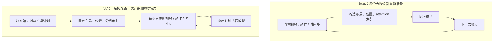
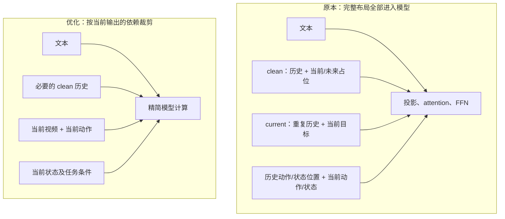
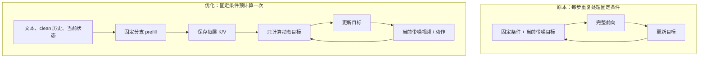
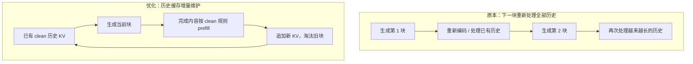
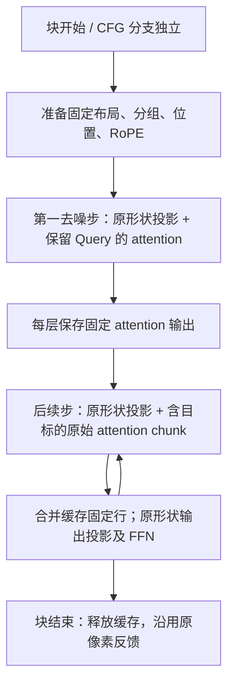

# Causal Cosmos3 推理 Attention 优化方案

本文整理非算子级推理优化方案及实施记录。下面的四阶段方案保留设计意图；实际落地范围与实测结果以文末“实施结果”为准。

**当前落地**：推理计划复用、完整 NPU attention chunk 裁剪、同块固定 attention 输出缓存。完整 rollout 平均耗时降低 22.1%，输出精确一致；没有启用物理 token 压缩、独立固定分支 prefill 或跨块 KV cache。

建议顺序为：**固定推理结构 → 精简 token → 同块缓存 → 跨块缓存**。本次实施要求无损：检查结果逐元素一致，不以误差较小代替无损。第 4 项涉及历史编码、位置和窗口更新，不能直接作为等价优化启用。

## 范围与代码入口

- [推理与采样](../../veomni/models/diffusers/causal_cosmos3/inference.py)：`rollout()`、`teacher_forcing()`、`sample_block()`。
- [去噪打包](../../veomni/models/diffusers/causal_cosmos3/cosmos3_core/denoise_packing.py)：块内布局与缓存生命周期。
- [Token 打包](../../veomni/models/diffusers/causal_cosmos3/cosmos3_core/packing.py)：布局、位置和模型输入。
- [Attention](../../veomni/models/diffusers/causal_cosmos3/cosmos3_core/attention.py)：可见范围、Query/KV 分组。
- [Transformer 层](../../veomni/models/diffusers/causal_cosmos3/cosmos3_core/layers.py)：投影、attention 和 FFN。
- [推理测试](../../tests/models/diffusers/test_causal_cosmos3_inference.py)。

本文的“每步”指同一个生成块内部的去噪步骤，不是机器人执行一个动作，也不是生成下一块。`clean` 指固定参考分支：rollout 的历史可以来自生成画面，并不意味着全部来自真实观测。

| 顺序 | 优化 | 主要解决的问题 | 对后续的铺垫 |
| --- | --- | --- | --- |
| 1 | 建立可复用的推理计划 | 每步重复构造布局、索引和位置数据 | 为精简布局、缓存提供稳定接口 |
| 2 | 精简推理 token | 不影响当前输出的 token 仍参与计算 | 明确固定条件与动态目标的边界 |
| 3 | 同块固定条件预计算与 KV cache | 多步去噪反复处理相同条件 | 建立 prefill 和只读采样机制 |
| 4 | 跨块滚动 KV cache | 生成下一块时重新处理历史 | 支持更长时间、持续推理 |

## 1. 建立可复用的推理计划

### 原本的问题与优化手段

同一块内主要变化的是视频、动作数值和去噪时间步，token 结构通常不变。如果每一步重新经过打包、位置构造和 attention 准备，就会重复执行结构性工作。

### 实现细节

- **分离结构和数值**：布局、角色、块编号、输出位置属于结构；当前 latent、动作、时间步属于动态数据。
- **复用 attention 分组**：Query/KV 索引和分组边界不必在每步重新创建、搬到设备。
- **复用位置数据**：结构不变时复用 position IDs 和可安全复用的 RoPE 表。
- **明确失效条件**：切换块、历史窗口变化、输入尺寸或任务模式变化时重建计划。
- **分别处理 CFG 布局**：正、负提示词长度可能不同，不能无条件共用完整布局。
- **保持计划只读**：采样更新不能污染参考数据或下次调用需要的结构。

### 优先级理由

这一项主要减少准备开销，未必有最大的总耗时收益，但可为后续精简与缓存提供稳定接口，适合先完成。

## 2. 精简推理 token

### 原本的问题与优化手段

完整布局保留 clean/current 双份视频，以及历史动作、状态位置。只生成当前块时，其中一些分支不影响最终取出的预测。

### 优先裁剪的内容

- current 分支中重复的历史视频。
- 当前块及未来块的 clean 占位。
- 不影响当前输出的历史动作、历史状态 token。
- teacher forcing 中对当前块没有影响的后续内容。

### 实现细节

- **保留 clean 历史角色**：不能直接改为 current 条件角色，否则可见范围可能改变。
- **区分任务条件**：`policy` 同时生成视频与动作；`forward_dynamics` 的动作是条件；`inverse_dynamics` 的视频是条件。
- **保持位置与时间步**：删除 token 后，不能简单重置剩余 token 的语义位置。
- **调整输出索引**：模型输出的视频和动作切片必须与新布局一致。
- **恢复解码结构**：将当前生成 latent 放回参考视频结构，满足现有 VAE 解码接口。
- **检查间接依赖**：更早的 clean 帧即使不被当前目标直接读取，也可能影响保留历史的深层表示。不能仅按当前目标的直接可见窗口删除历史。

### 优先级理由

精简 token 可以同时减少投影、attention 和 FFN 工作，并将输入明确拆为“固定条件 + 动态目标”，为缓存建立边界。

## 3. 同块固定条件预计算与 KV cache

### 原本的问题与优化手段

同一块去噪期间，文本、clean 历史和当前状态固定，当前视频和动作变化。固定条件只需计算一次，后续去噪只运行动态目标分支。

### 两种实现深度

| 阶段 | 做法 | 局限 |
| --- | --- | --- |
| 过渡实现 | 缓存固定 K/V 和固定 attention 输出 | 完整投影、FFN 可能仍在重算 |
| 完整实现 | 固定分支独立 prefill，后续只运行动态目标 | 需要专用模型推理接口 |

两者不是必须长期叠加的两层缓存。完成前两项后，可以直接评估完整实现；较小改动的 attention 输出缓存可作为过渡方案。

### 实现细节

- **按层保存**：每层的 K/V 不同，不能只缓存输入层结果。
- **保留条件内部掩码**：prefill 中仍需遵守文本、clean 历史与状态的原始可见规则。
- **目标仍需读取历史**：目标 Q 每步变化，`Q × K历史ᵀ` 与 softmax 仍需计算，不能复用目标读取历史的注意力权重。
- **去噪只读缓存**：不把当前噪声 K/V 写成永久历史。
- **隔离 CFG**：正、负提示词需要独立缓存；`guidance=1` 时只创建一套。
- **仅用于无梯度推理**：不影响训练路径。
- **明确失效**：切块或条件改变时失效，先保证同块复用，再扩展跨块生命周期。
- **完整提交**：prefill 所有层成功后才允许读取；失败时丢弃不完整缓存。

### 优先级理由

这是减少多步去噪重复计算的关键步骤，但依赖清晰的固定/动态边界。收益需实测，受历史长度、目标大小和 VAE 耗时影响。

## 4. 跨块滚动 KV cache

### 原本的问题与优化手段

同块缓存完成后，新块仍可能重新 prefill 全部历史。跨块缓存让已完成的 clean 历史保留下来，只增量追加新内容。

### 实现细节与语义边界

- **完成块重新 clean prefill**：不能直接复用最后一步目标 K/V；目标与 clean 分支的时间步和可见范围不同。
- **保证历史表示稳定**：当前像素反馈路径会重新编码历史；如果 latent 改变，旧 KV 不再有效。
- **维护时间位置**：新块不能重复使用首帧位置；位置变化需要正确处理或失效缓存。
- **明确窗口语义**：缓存中保留的历史表示可能已经吸收被淘汰的上下文，与裁剪后重新计算未必等价。
- **区分视觉历史和状态**：按现有规则保留 clean 视频历史，不随意增加对历史状态、动作的可见性。
- **处理实际反馈**：预测画面被真实相机观测替换时，使相关缓存失效或重建。
- **有界存储**：使用预分配或可控增长的滚动存储，按完整块记录元数据、淘汰历史。
- **分层暂存、统一提交**：避免部分层更新；CFG 两个分支保持提交一致。
- **最后一块是否 prefill**：一次性请求结束后可跳过；持续会话可能还需要为下一轮保留缓存。

### 优先级理由

这项应最后实施，因为它不只是复用计算，还涉及历史的定义。像素反馈、latent 反馈和 KV 反馈不能在优化过程中被默默替换。需要先明确是否要求与当前路径严格等价。

## 与上游实现的对应关系

参考仓库为 [Robotic-causal-cosmos-framework-ascend](https://github.com/Meta-Intelligence-Project/Robotic-causal-cosmos-framework-ascend)，讨论时检查的提交为 `291e9941270403851211bec4aacc1d1512808a51`。

- [动作缓存](https://github.com/Meta-Intelligence-Project/Robotic-causal-cosmos-framework-ascend/blob/291e9941270403851211bec4aacc1d1512808a51/cosmos_framework/model/generator/mot/causal_action_cache.py)：同块复用固定 K/V 与 attention 输出，但投影和 FFN 仍重复执行；新块清空缓存。
- [动作打包](https://github.com/Meta-Intelligence-Project/Robotic-causal-cosmos-framework-ascend/blob/291e9941270403851211bec4aacc1d1512808a51/cosmos_framework/data/generator/sequence_packing/causal_action.py)：仍保留 clean/current 双份视频布局。
- [纯视频缓存推理](https://github.com/Meta-Intelligence-Project/Robotic-causal-cosmos-framework-ascend/blob/291e9941270403851211bec4aacc1d1512808a51/cosmos_framework/model/generator/omni_mot_causal_model.py)：当前块精简打包、只读历史 KV、完成后 clean prefill，并采用滚动历史缓存。

动作路径与纯视频路径不能混为一谈。本方案既覆盖这些主要思路，也提出对当前动作推理的进一步精简。

## 验证与性能评估

保留现有实现作为参考路径，固定输入、初始噪声和时间步。先验证计算等价性，再评估性能，不以最终视频看起来相似代替数值检查。

| 阶段 | 重点比较 |
| --- | --- |
| 推理计划复用 | token 标签、位置和 attention 可见集合 |
| 精简 token | 当前目标的单次前向输出 |
| 同块缓存 | 每个去噪步的视频/动作预测与最终块结果 |
| 跨块缓存 | 多块输出、窗口淘汰边界、观测替换后的行为 |

覆盖首次生成、已有历史、非完整尾块、CFG 和三种任务模式。测试应检查真实行为与失效边界，不仅复述实现。

分别记录准备、prefill、每步模型前向、VAE、总耗时和峰值显存。对照时保持设备、模型精度、输入尺寸、历史长度、采样步数等一致，区分冷启动和稳定运行；数值容差需结合精度及执行路径设定，不预先承诺加速倍数。

建议将第 1、2 项作为第一阶段，再完成第 3 项。第 4 项独立推进，先明确历史更新契约，再决定缓存保留与失效策略。

## 实施结果（2026-10-31）

### 实际保留的计算路径

1. **可复用推理计划**：每块、每个 CFG 分支准备一次布局、attention 分组、固定 patch、位置和 RoPE 表，每个去噪步只更新动态输入和时间步。
2. **只裁剪无关 attention Query**：保留完整投影及 FFN 输入形状；跳过不影响当前目标的 Query 计算，并将结果放回原始行位置。NPU 只删除整个原始 TND chunk，不在 chunk 内删组；只要有一组需要保留，就保留完整调用。保留所有更早 clean 帧，避免破坏多层间接依赖。
3. **同块固定 attention 输出缓存**：首步逐层保存文本与固定 GEN 行的 attention 输出；后续重算包含目标的完整 NPU chunk，再恢复其他固定行。这里没有缓存 K/V 投影，投影和 FFN 仍按原形状执行；没有可跳过 chunk 的短历史不启用输出缓存。

### 没有引入的优化及原因

- **物理缩短 token 序列**：真实 checkpoint 的 BF16/NPU 对照出现差异。相同初始噪声、20 步去噪后，latent 最大绝对差约 `0.0195018`，action 约 `0.0071581`。虽然依赖裁剪在数学上成立，改变矩阵形状仍会改变浮点计算结果。因此放弃该原型，改为保持矩阵形状的 Query 裁剪。
- **NPU chunk 内删 Query 分组**：虽保持每组 KV 顺序，仍改变融合调用的总长度及组偏移。满历史 3 步、CFG=1 时 latent 最大绝对差 `0.0329572`、action `0.0118529`；CFG=3 时分别为 `0.115636`、`0.0260156`。该版本平均每块 18.614 秒，叠加缓存为 15.807 秒，但完整 rollout 动作和视频均不一致，因此都未采用。最终版本保留每个执行 chunk 的完整调用形状。
- **固定分支独立 prefill、动态分支独立投影/FFN**：同样会改变矩阵形状，未满足本次严格无损要求，未启用。当前只缓存 attention 输出。
- **跨块历史 KV cache**：当前 `rollout()` 使用像素反馈，历史重新经过 VAE；窗口截断后还会重建位置与历史上下文。旧 clean KV 不具备可直接沿用的保证，且不能拿上一块目标分支的 KV 当 clean KV。无效时全部重建的缓存没有预期收益，因此本次未引入，也没有改变反馈语义。

### 对照方法

复用仓库已有的 `scripts/inference/infer_causal_cosmos3.sh` 和 `RolloutProfiler`，没有增加 profiler 框架。基线为 `614cf4dd`。设备为 Ascend 910B3；同一 checkpoint、BF16、`npu_tnd`，Agibot task_352 episode 0，history 32，CFG 1，每块 32 actions、20 个去噪步；完整预热一次，再测 20 块 / 640 actions，未开启 trace。比较 `actions.npz` 的全部数组和 `generated.mp4` 的 SHA-256，同时进行模型输出对照。

显存同时记录 PyTorch allocated 和 reserved；它们不包含全部驱动/运行时开销。24 GB 的验证仅对应这里给定的模型、分辨率、历史长度和 CFG 设置，不代表任意配置的显存上限。

### 数值验收与回归覆盖

- 原始路径与推理计划复用：完整 640-action rollout 的 `actions.npz` 全部数组精确一致，视频 SHA-256 一致。
- 满历史硬件隔离：129 帧像素历史，分别使用 CFG=1/3、3 步去噪，对照原始路径、计划复用、完整 chunk 裁剪、完整 chunk 缓存；全部 latent/action 逐元素一致。
- 满历史长采样：CFG=3、20 步去噪，原始路径与 chunk 缓存的 latent/action 最大绝对差均为 0；峰值 allocated `18.426 GB`、reserved `21.211 GB`（该单块测试，不含完整 rollout 的 VAE decode 阶段）。
- 单元测试覆盖 policy/fd/id、CFG、历史窗口、固定条件、计划失效、不同调用的缓存隔离，以及固定 attention 调用次数。NPU 测试对同一份 Q/K/V 比较完整路径与裁剪路径，并检查执行 chunk 与原始对象一致。
- 核心模型套件的两项权重加载日志测试在基线 checkout 也失败，原因是环境中的 `trust_remote_code` warning 被捕获为意外日志；不是此次改动新增。对应测试为 `test_skipping_parameters_initializes_missing_unless_explicitly_restricted[True]` 与 `test_default_missing_initialization_warns_and_preserves_loaded_parameters`。工作期间这项问题由独立提交 `da5fa3b8` 修复；包含该提交的最终工作区测试为 **272 passed、2 skipped**。

复核时使用 `sample_block(..., reuse_denoise_packing=False)` 恢复原始路径；关闭同块缓存使用 `cache_fixed_attention=False`；关闭裁剪及缓存使用 `prune_attention=False`。这些是 Python 采样接口选项，不是新增 CLI 参数。

### 裁剪收益的同卡补充对照

完整 TND chunk 裁剪只在部分布局能删除整个调用，收益并非随历史长度单调增长。使用同一张 NPU 7、同一份 121 帧历史、相同初始噪声、20 步去噪，先预热两条路径，再用现有 `RolloutProfiler` 记录 `sample_block`：仅计划复用为 `24.478 s`，计划复用加裁剪为 `20.460 s`，降低约 `16.4%`，两次输出逐元素一致。这里不包含 VAE，也不是完整 rollout 的平均加速；完整平均值见最终结果表。

### 最终性能结果

最终完整 rollout 为 **18.465 秒/块**，相对基线 `23.712 秒/块` 降低 **22.1%**；采样阶段从 `16.921` 降至 **11.617 秒/块**，降低 **31.3%**。最终 640 actions 及 mask、动作/视频时间戳数组全部逐元素一致，161 帧输出视频的 SHA-256 相同。最终峰值 allocated **14.597 GB**、reserved **17.207 GB**；当前 CFG=1 配置符合 24 GB 预算。

使用原来的命令即可启用这些优化，无需修改推理配置。物理 token 压缩和跨块缓存仍未启用。

最终视频 SHA-256：`4e240a457a7dd1b25abf93b80f0d9cdb03278c8b662ca178552d85a57517c207`。

| 阶段 | Commit | 平均块耗时（s） | 平均采样（s） | 峰值 allocated（GB） | 峰值 reserved（GB） |
| --- | --- | ---: | ---: | ---: | ---: |
| 原始基线 | `614cf4dd` | 23.712 | 16.921 | 14.038 | 17.195 |
| 1. 推理计划复用 | `a75ebfb0` | 21.671 | 14.877 | 14.040 | 17.195 |
| 2. 加完整 chunk 裁剪 | `abe57256` | 21.495 | 14.695 | 14.040 | 17.195 |
| 3. 加固定 attention 输出缓存 | `c27905f5` | 18.465 | 11.617 | 14.597 | 17.207 |

相对前一阶段，平均块耗时依次降低约 **8.6%、0.8%、14.1%**。独立裁剪的整体收益较小，仅在部分布局可以跳过完整调用；主要收益来自计划复用和固定 attention 输出缓存。上述各阶段完整输出都与基线精确一致。

本机测量文件：

- 基线：`outputs/attention_opt_baseline/profile.json`（NPU 6）。
- 计划复用：`outputs/attention_opt_plan/profile.json`（NPU 7）。
- 裁剪单项：`outputs/attention_opt_pruning_accepted/profile.json`（NPU 3）。
- 最终版本：`outputs/attention_opt_accepted/profile.json`（NPU 4）。
- 数组及视频哈希对照汇总：`outputs/attention_opt_validation.json`。

各卡均为 Ascend 910B3；为区别小幅收益与卡间波动，额外进行了前述同卡裁剪开关对照。输出目录是本机实验产物，不提交到仓库。测试命令覆盖 `tests/models/diffusers/test_causal_cosmos3_inference.py`、`test_causal_cosmos3_packing.py` 和 `test_causal_cosmos3.py`；最终 **272 passed、2 skipped**，`make quality` 通过。使用锁文件对应的 Ruff `0.13.2`，未修改依赖或现有 profiler。
